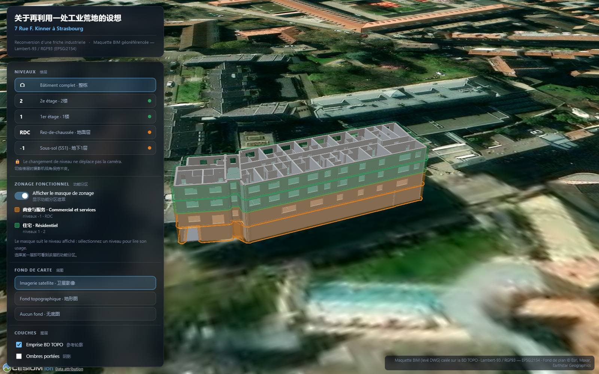

# Revalorisation d'une friche industrielle — Web map 3D

> **7 Rue Fritz Kiener à Strasbourg** — reconversion d'une friche industrielle
> Maquette BIM géoréférencée (Lambert-93 / RGF93 — EPSG:2154), lecture par niveau
> et masque de zonage fonctionnel.

Ce dossier est un site **statique** (aucun serveur applicatif, aucune base de
données) : il peut être publié tel quel sur GitHub Pages, Netlify, un intranet,
ou simplement servi par un petit serveur HTTP local.



---

## 1. Contenu

```
web/
├── index.html                 page unique (viewer CesiumJS)
├── css/style.css              mise en page, thème, responsive (PC / tablette)
├── js/app.js                  logique : niveaux, zonage, caméra, fonds de carte
├── data/
│   ├── meta.json              paramètres : titres, origine géographique, niveaux,
│   │                          usages, emprises de zonage, caméra initiale
│   ├── ss1.glb  rdc.glb       un modèle 3D par niveau (glTF binaire)
│   ├── etg1.glb  etg2.glb
│   └── ref_bdtopo.geojson     emprise BD TOPO utilisée pour le calage
├── .nojekyll                  demandé par GitHub Pages
└── README.md
```

Poids total : environ **1,3 Mo**. Aucune dépendance locale : CesiumJS 1.126 est
chargé depuis un CDN (jsDelivr).

---

## 2. Lancer en local

Un serveur HTTP est nécessaire (`fetch()` est bloqué en `file://`) :

```powershell
cd web
python -m http.server 8777
# puis ouvrir http://127.0.0.1:8777/
```

---

## 3. Publier sur GitHub Pages

1. Créer un dépôt **public** sur GitHub, par exemple `friche-kiener-webmap`
   (ne rien initialiser : ni README, ni .gitignore).
2. Depuis ce dossier (`web/`), pousser le contenu **à la racine** du dépôt :

   ```powershell
   git init
   git add .
   git commit -m "Web map 3D - friche industrielle, Strasbourg"
   git branch -M main
   git remote add origin https://github.com/<utilisateur>/<depot>.git
   git push -u origin main
   ```

3. Activer la publication, **une seule fois** :
   **Settings → Pages → Build and deployment**

   - *Source* : `Deploy from a branch`
   - *Branch* : `main`, dossier `/ (root)` → **Save**

   Cette étape est manuelle : GitHub exige les droits d'administration du dépôt
   pour *créer* le site Pages, droits que le jeton des Actions ne possède pas.
   Il n'existe donc pas de contournement automatisable.
4. Attendre 1 à 2 minutes, puis ouvrir :

   `https://<utilisateur>.github.io/<depot>/`

Le site est alors accessible depuis un PC **et** une tablette, à la même adresse.
Tous les chemins du projet sont relatifs : le sous-dossier `/<depot>/` ne pose
aucun problème. Chaque `git push` sur `main` republie le site automatiquement.

> Si une connexion Git demande une authentification, utiliser un
> *Personal Access Token* (Settings → Developer settings) comme mot de passe.

**Variante « dépôt unique »** : si l'on veut garder le projet complet dans un
seul dépôt, placer le contenu de `web/` dans un dossier `docs/` et choisir
`/docs` comme dossier de publication à l'étape 3.

---

## 4. Fond de carte Esri et clé d'API

### 4.1 Fonctionnement sans clé (par défaut)

Le site interroge les services raster « historiques » d'Esri, qui répondent
**sans inscription** :

| Usage | Service |
|---|---|
| Imagerie satellite | `services.arcgisonline.com/ArcGIS/rest/services/World_Imagery/MapServer` |
| Fond topographique | `services.arcgisonline.com/ArcGIS/rest/services/World_Topo_Map/MapServer` |
| Étiquettes | `services.arcgisonline.com/ArcGIS/rest/services/Reference/World_Boundaries_and_Places/MapServer` |

Aucune clé n'est donc nécessaire pour que la carte s'affiche. C'est le mode
livré par défaut.

### 4.2 Obtenir une clé API ArcGIS

1. Créer un compte développeur gratuit sur
   <https://developers.arcgis.com/> (*Sign up* — un compte public suffit).
2. Dans le tableau de bord : **API keys → Create API key**.
3. Titre au choix (par exemple `friche-kiener-webmap`).
4. **Privilèges** : cocher uniquement *Location services → Basemaps*, qui couvre
   l'imagerie et le relief. Ne rien cocher d'autre.
5. **Scopes** : `Basemaps` (+ `Geocoding` inutile ici). Un référentiel
   (*referrer*) peut être ajouté pour restreindre la clé au domaine
   `https://<utilisateur>.github.io/*`.
6. Copier la clé (`AAPK…`). Elle est **publique par nature** : elle est de toute
   façon visible dans l'URL et dans le code de la page, c'est le référentiel
   qui la protège.

### 4.3 Utiliser la clé

Trois façons, par ordre de priorité :

| Méthode | Portée |
|---|---|
| `?esri=AAPK…` ajouté à l'adresse du site | test immédiat ; la clé est mémorisée par le navigateur |
| `window.ESRI_API_KEY = 'AAPK…'` dans un `js/config.js` chargé avant `app.js` | installation permanente sur un site dédié |
| clé mémorisée par une visite précédente | automatique |

`?esri=off` efface la clé mémorisée.

Exemple d'adresse de test :

```
https://<utilisateur>.github.io/<depot>/?esri=AAPKxxxxxxxx
```

Avec une clé, `js/app.js` :

1. déclare `Cesium.ArcGisMapService.defaultAccessToken = clé` ;
2. sert l'imagerie via `ArcGisMapServerImageryProvider.fromBasemapType(
   Cesium.ArcGisBaseMapType.SATELLITE, { token })`, donc par le service officiel
   `ibasemaps-api.arcgis.com` ;
3. ajoute une entrée **Relief ombré (Esri)** (`ArcGisBaseMapType.HILLSHADE`)
   dans le menu *Fond de carte* ;
4. affiche l'état de la clé sous le menu.

Le fond topographique et les étiquettes restent sur `services.arcgisonline.com`,
ces couches n'étant pas exposées par le service officiel dans CesiumJS 1.126.

### 4.4 Enregistrer la clé dans un `js/config.js`

Créer `web/js/config.js` :

```js
/* chargé avant app.js, non versionné si la clé doit rester locale */
window.ESRI_API_KEY = 'AAPKxxxxxxxxxxxxxxxxxxxx';
```

puis, dans `index.html`, juste avant `<script src="js/app.js"></script>` :

```html
<script src="js/config.js"></script>
```

> ⚠️ Si ce fichier est poussé sur GitHub, la clé devient publique — ce qui est
> admis par Esri **à condition** d'avoir restreint la clé à votre domaine
> (référentiel). Sinon, l'ajouter à `.gitignore`.

### 4.5 Contrôle du bon fonctionnement

Ouvrir la console du navigateur : les requêtes doivent viser
`ibasemaps-api.arcgis.com`. En cas d'échec du service officiel, le code
retombe automatiquement sur le service en accès libre.

---

## 5. D'où viennent les données affichées

Les fichiers de `data/` sont **générés**, pas écrits à la main :

```powershell
& "C:\Program Files\ArcGIS\Pro\bin\python\envs\arcgispro-py3\python.exe" _work\export_web.py
```

`_work/export_web.py` :

1. lit les solides de la maquette (`_work/BIM_3D_solides.csv` + `_work/obj3d/*.obj`) ;
2. leur applique la transformation de calage enregistrée dans
   `_work/georef_params.json` (rotation **7,10505°**, translation
   **(1050888,413 ; 6841989,874)**, échelle **1,000**, décalage vertical **+139,50 m**) ;
3. convertit le tout dans un repère **ENU** (Est/Nord/Haut) centré sur la
   parcelle, en tenant compte de la **convergence des méridiennes** (−3,4588°) ;
4. écrit un `.glb` par niveau (attributs → un matériau par famille : murs
   extérieurs, murs intérieurs, dalles, escaliers) ;
5. calcule l'enveloppe de chaque niveau (`MultiPatchFootprint` + `Dissolve` +
   `Buffer` de 0,60 m) qui sert de **masque de zonage** ;
6. écrit `meta.json` et `ref_bdtopo.geojson`.

> ⚠️ Le script doit être relancé **après** tout changement de la maquette
> (`_work/build_bim3d.py`), mais **avant** de republier le site.

> ⚠️ `_work/build_bim3d.py` reconstruit `BIM.gdb/BIM_3D` **dans le repère local**
> et écrase donc le géoréférencement. Après toute reconstruction, il faut
> relancer `_work/georef.py` (qui remet `BIM_3D` et `Polylines_3D` en
> Lambert-93) **avant** `_work/export_web.py`, car `export_web.py` attend des
> anneaux déjà en EPSG:2154.

### Ouvrages écartés du modèle

`_work/build_bim3d.py` contient une liste `EXCLURE` (zones en coordonnées
locales). Tout ouvrage dont **tous** les points tombent dans une zone est
retiré de la maquette. Une entrée y figure :

| Ouvrage | Zone (x min, x max, y min, y max) | Motif |
|---|---|---|
| Enveloppe de quatre parois (3,29 × 1,32 m) autour de l'escalier de la sortie de secours RDC → SS1, au sud de la façade | −28,15 / −24,40 / −10,90 / −9,15 | ouvrage inexistant dans l'état actuel des lieux |

L'escalier lui-même (`S000325` … `S000340`) **n'est pas** concerné : seules les
quatre parois ont été retirées.

---

## 6. Commandes de la carte

| Commande | Effet |
|---|---|
| **Niveaux** | Affiche un niveau (ou le bâtiment complet). **La caméra ne bouge jamais** lors du changement de niveau. |
| **Afficher le masque de zonage** | Active/désactive les volumes de zonage : **résidentiel** en vert (1er et 2e étage), **commercial et services** en orange (rez-de-chaussée et sous-sol). |
| **Fond de carte** | Imagerie satellite (Esri World Imagery), fond topographique (Esri World Topographic Map), relief ombré (si clé API) ou aucun fond. |
| **Couches** | Emprise BD TOPO de référence, ombres portées. |
| **Réinitialiser la vue** | Revient au cadrage oblique d'ouverture. |
| **Plein écran** | Passage en plein écran (utile sur tablette). |

Navigation : clic gauche = rotation, clic droit / deux doigts = zoom,
molette = zoom, tactile = pincer/glisser.

---

## 7. Notes techniques

- **Repère** : les modèles sont écrits en glTF **Y-up** classique
  (X = est, Y = haut, Z = sud). CesiumJS 1.126 applique par défaut une
  correction d'axes *composée* (`Y_UP_TO_Z_UP × Z_UP_TO_X_UP`) qui produit une
  rotation parasite de 90° en plan ; elle est donc désactivée
  (`upAxis: Z`, `forwardAxis: X`) et la rotation Y-up → Z-up est appliquée
  explicitement dans `js/app.js` (`matriceYVersZ()`).
- **Altimétrie** : les hauteurs sont relatives, `U = altitude NGF − 139,0 m`
  (sol du site, `altitude_minimale_sol` de la BD TOPO). Aucun modèle numérique
  de terrain n'est chargé : le fond de plan tient lieu de sol.
- **Sous-sol** : le niveau −1 descend à −3,70 m ; il reste visible car
  CesiumJS n'occulte pas les objets situés sous l'ellipsoïde
  (`depthTestAgainstTerrain` désactivé, valeur par défaut).
- **Fond de plan** : par défaut Esri World Imagery / World Topographic Map, via
  les services en accès libre `services.arcgisonline.com` (aucune clé). Si
  `?esri=<clé>` est fourni, l'imagerie et le relief passent par le service
  officiel `ibasemaps-api.arcgis.com` (voir § 4). Le géoréférencement de
  l'imagerie Esri peut différer de quelques mètres de celui de la BD TOPO (IGN),
  qui fait foi ici.
- **Version figée** : CesiumJS 1.126.0 (CDN jsDelivr). Pour figer également le
  CDN, télécharger `Build/Cesium/` dans `vendor/cesium/` et adapter les deux
  balises de `index.html` ainsi que `CESIUM_BASE_URL`.

---

## 8. Sources

- Levé DWG — *interior design, Strasbourg* (`F_RdC_V2`, `F_RdC_V3`).
- BD TOPO 2021 — bâtiment `BATIMENT0000002223298023` (IGN).
- Calage : ajustement rigide sur l'emprise BD TOPO (voir
  `BIM_3D_georeferencement.md`), résidu médian 0,44 m.
- Fond de plan : © Esri, Maxar, Earthstar Geographics.
